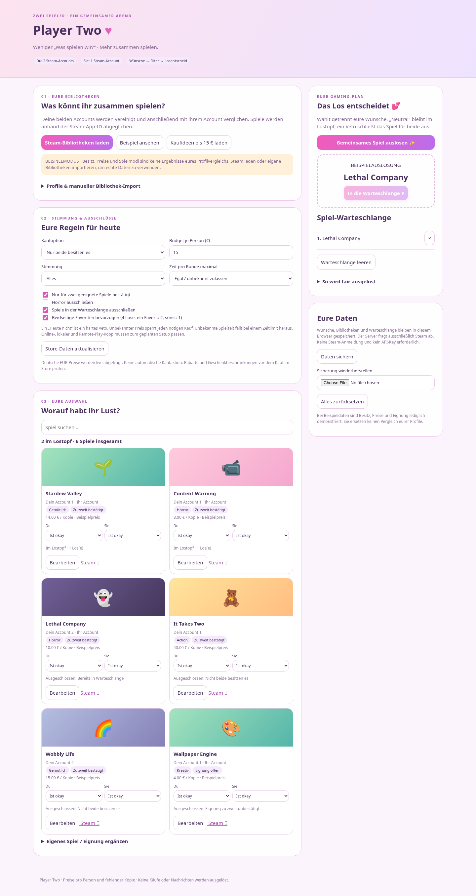

# Player Two ♥

Spiele-Zufallsrechner für zwei Personen mit Steam-Bibliotheksvergleich, Favoriten, Vetos, Kaufbudget, Filtern und Warteschlange.

## Starten

Python 3.10 oder neuer, keine zusätzlichen Laufzeitpakete:

```bash
cd steam-match
python3 server.py
```

Anschließend im lokalen Browser `http://127.0.0.1:8080` öffnen.

[Anleitung und Datenlage](steam-match/README.md) · [Mobile Vorschau](steam-match/mobile.png)

Der automatische Bibliotheksabruf nutzt die offizielle Steam Web API. Dafür `STEAM_API_KEY` als geheime Umgebungsvariable auf dem Server setzen; alle drei Profile und Spieldetails müssen öffentlich sein. Bibliotheken können separat importiert werden. Beispieldaten sind gekennzeichnet; Kaufideen bestätigen keinen Besitz.


